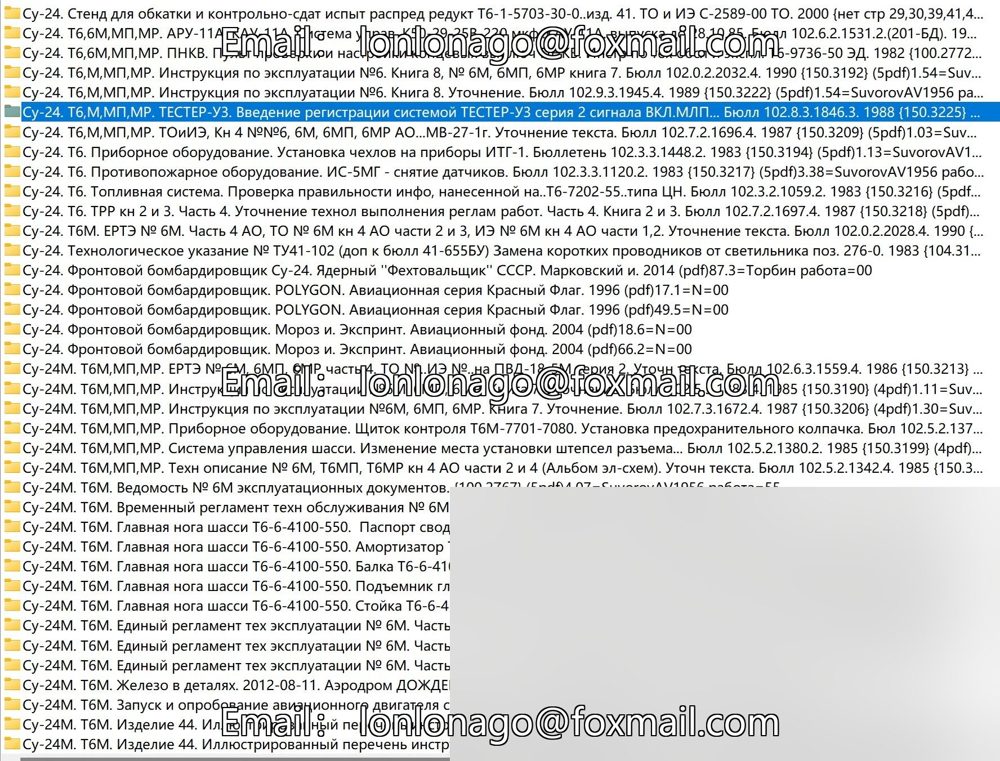
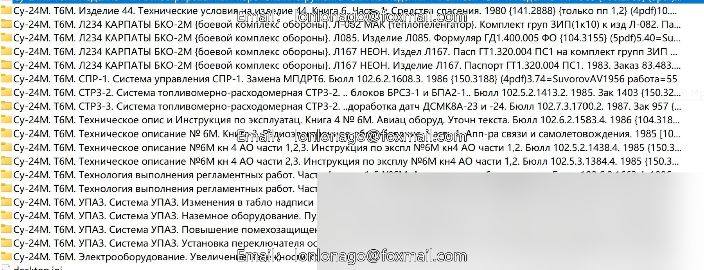

# Soviet/Russian frontline bombing aircraft Su-24 and its improved models Su-24M technical documents

## Body

The technical documents collection of the Soviet/Russian front bombardment aircraft Su-24 and its improved Su-24M
    The documents were released between 1980-2014, reflecting the full cycle of technical documents from the service of the Su-24 series to its improvements.

1. **File subject**: Includes documents on the basic SU-24 and upgraded SU-24M, involving technical manuals, operation guides, system descriptions, test equipment, etc.
2. **File types**: Covering technical conditions (Technical conditions), operation instructions (Operational instructions), system descriptions (System description), test equipment (TESTER-UD), maintenance guides (Maintaining guides) etc.
3. **Key content classification**
   (1) SU-24 basic version

​​Test Equipment​​: Relevant documents related to the "TESTER-USE" testing instrument (released in 1988, file size 150.3225).
​​System Description​​: Examples such as "ARU-11A" and "KAU-11A" control systems (released before 1985).
​​Operation Manual​​: Multiple operation guides numbered "№6" (such as the "Knight Eight" part of the "Knight 8" released in 1989).
​​Historical Files​​: Including maintenance bulletins and technical revisions published between 1983-1990.
​​(2) Su-24M Improved Type​​

Technical conditions: such as "T6M" series technical documents (released in 1980, involving "Book 6" part 1).
System upgrade: For example, "STRZ-2", "STRZ-3" systems (1985-1987 document), and "PVD-18-5M" equipment (1983 revision).
Operation and maintenance: Multiple "Instructions for Operation No. 6M" manuals (such as the 1985-1987 version).
Electronic and mechanical components: For example, "Control panel installation instructions for T6M-7701-7080" control panel, (1985).

The collection covers technical documents for the Su-24 and its improved Su-24M, including technical conditions, operation instructions, system descriptions, testing equipment and maintenance guides.

<!-- AI_ENRICHED -->

## Images

## Payment

Here is a pay link on Stripe ( https://buy.stripe.com/3cs8yP7sY87d0vu9AB ). Please contact me lonlonago@foxmail.com after funding $89, and I will send you a complete data files , thank you!

